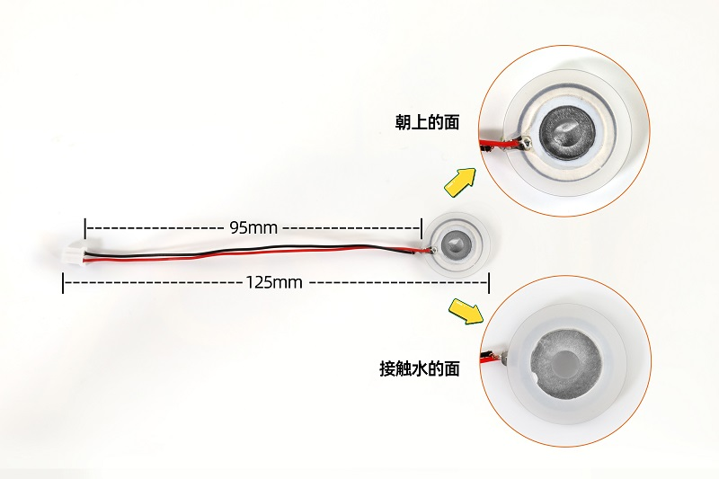
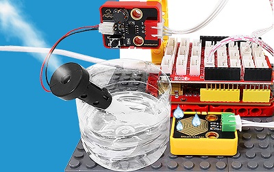
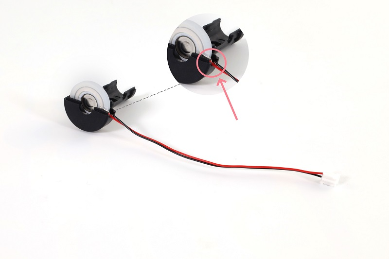
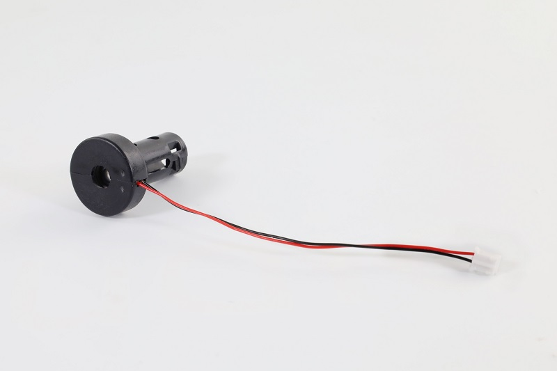
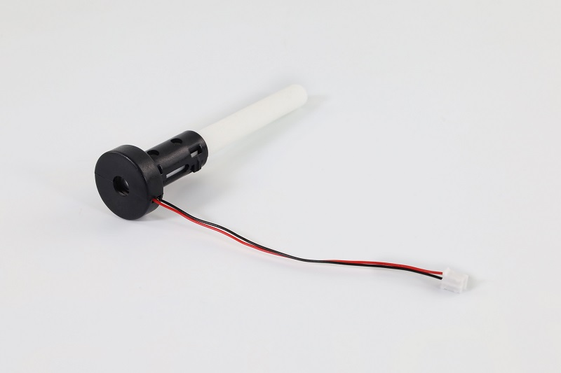
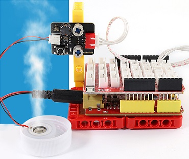

# Arduino 使用教程

## 资料下载

- 下载代码[atomization_demo(Arduino)](./atomization_demo(Arduino).7z)

## 实验代码

```c
int atomization = 3;  //定义雾化模块连接引脚
void setup() {
  pinMode(atomization, OUTPUT);//设置引脚为输出模式
  digitalWrite(atomization, HIGH);//初始化引脚为高电平   
}

void loop() {
  //开启雾化模块，相当于按键按下
  digitalWrite(atomization, LOW);   
  delay(200);  
  digitalWrite(atomization, HIGH); 
  delay(3000); 
  //关闭雾化模块，按键再次按下
  digitalWrite(atomization, LOW); 
  delay(200); 
  digitalWrite(atomization, HIGH);   
  delay(1000);
}
```


## 代码说明

| 代码                            | 说明                                                       |
| ------------------------------- | ---------------------------------------------------------- |
| pinMode(atomization, OUTPUT)    | 将引脚设置为输出模式。                                     |
| digitalWrite(atomization, HIGH) | 设置引脚的输出电压为高\低电平。HIGH为高电平，LOW为低电平。 |
| delay(1000)                     | 将程序的执行暂停一段时间,也就是延时。单位是毫秒。          |


## 实验结果

### 雾化片

**注意：雾化片正面朝上，雾化片轻置于水面之上，正面不要被水覆盖。**



将示例代码上传到主板，上传成功后，按照接线图接好线，把雾化片放水面，雾化片开始工作，按照喷雾3秒，停1秒的规律循环交替。




### 加湿棉棒

安装加湿棉棒步骤：

将雾化片安装至塑料支架内部。注意雾化片的方向，雾化片的连接线放置在塑料支架凹槽处。




将另一边塑料支架装上。




将棉棒插入塑料支架中间。



安装完成。

**注意：由于棉棒吸水需要时间，为了避免模块上电后棉棒未吸满水导致雾化片烧坏，请先将棉棒插入水中，待吸满水后再上传代码进行实验。**


按照接线图接好线，把棉棒插入水里，等待2~3分钟棉棒吸满水后，将示例代码上传到主板，上传成功后雾化片开始工作，按照喷雾3秒，停1秒的规律循环交替。



请注意，由于棉棒吸水的速率较慢，长时间工作后可能会导致雾化片每工作一段时间就会停止2~3秒，待棉棒吸水充足后又继续工作。