# Kidsblock使用教程

## 资料下载

- 下载代码[atomization_demo(Kidsblock)](./atomization_demo(Kidsblock).7z)

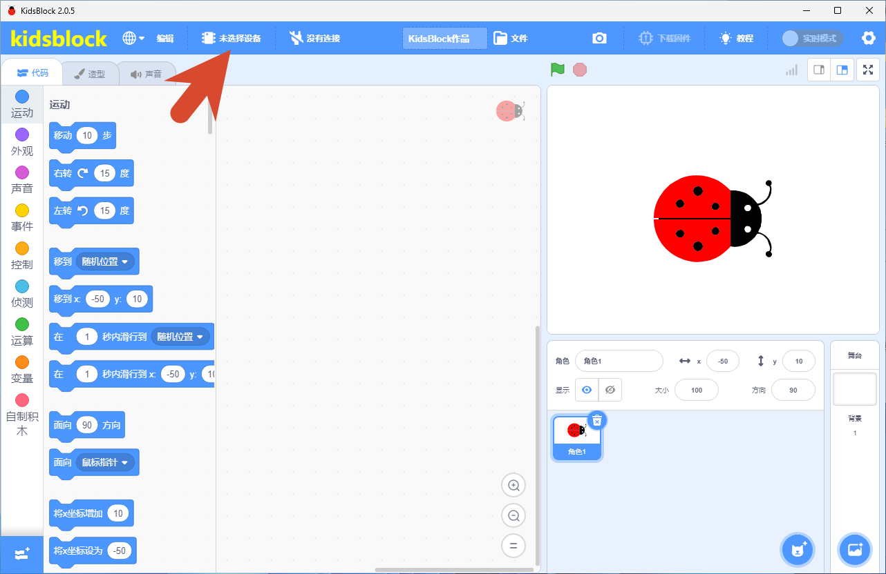

## 软件准备

下载Kidsblock IDE参考Kidsblock的网站：[Software | Kidsblock](https://www.keyesrobot.cn/projects/KidsBlock/)

使用kidsblock 软件进去之后点击选择好板子类型

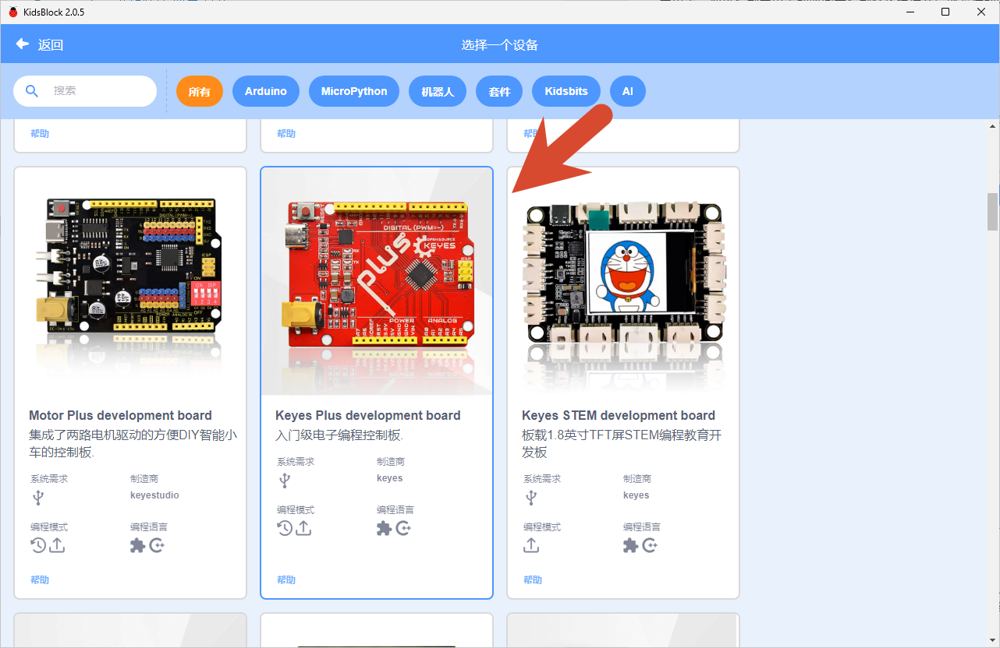

然后去左侧点击到对应的类型区域选择相应的块

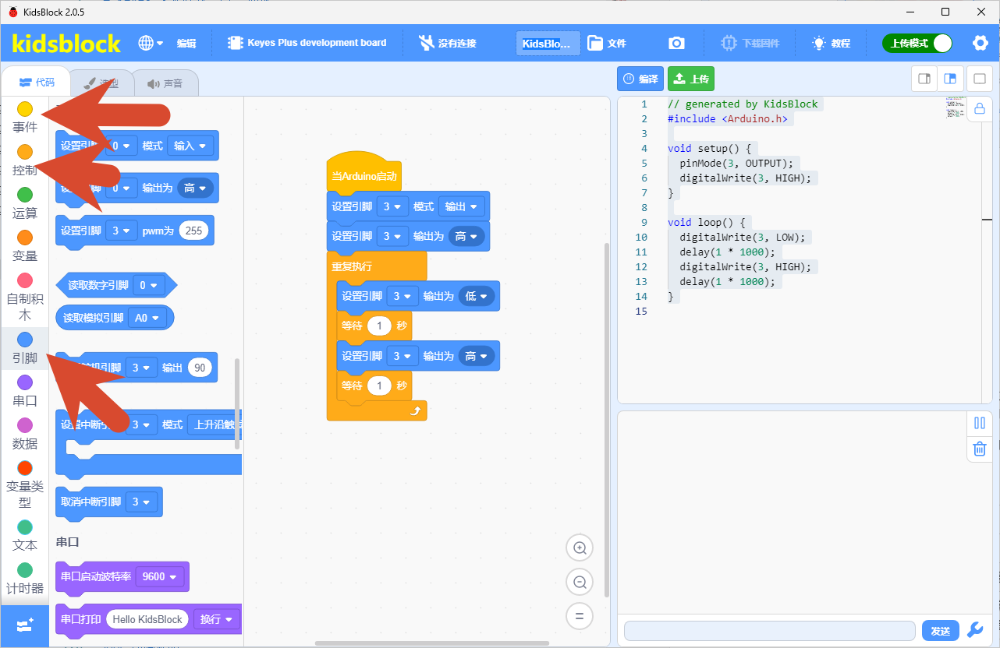

选择好正确的串口连接好

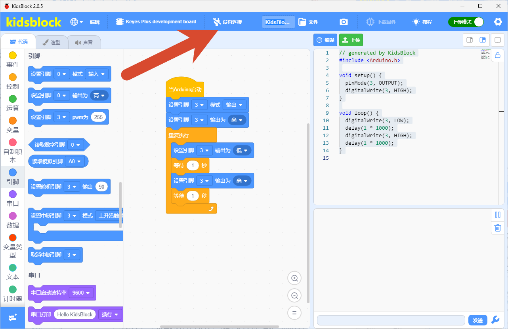

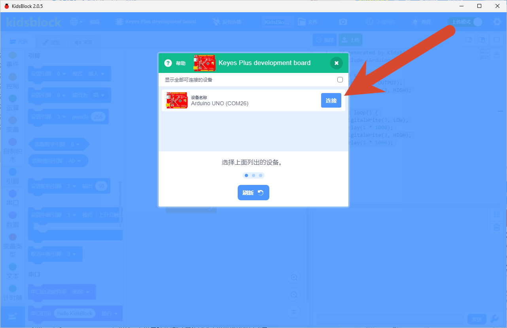

写好代码后点击上传代码即可

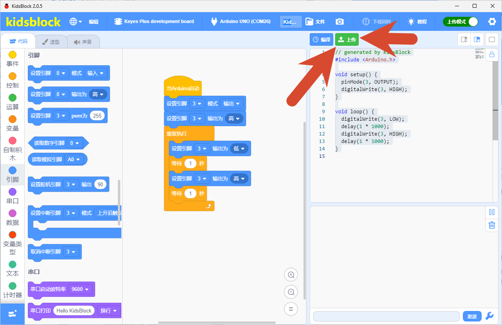

## 接线图

按照接线图将模块用杜邦线正确连接至主控板，再将主控板用USB线连接至电脑，Kidsblock IDE ，查看是否有端口。若无端口，检查是否安装驱动。有端口，则继续往下进行。

**注意：** 若使用其它主板，连接至其对应的SCL、SDA接口即可。

## 上传代码

| 传感器运行状态 | 解释                                                         |
| -------------- | ------------------------------------------------------------ |
| 0              | 正常运行                                                     |
| 1              | 预热，上电后前3分钟（需传感器不再出现初次启动状态）          |
| 2              | 初次启动，上电后前1小时（传感器连续工作24小时后将不再出现该状态，如果中途出现断电，重新上电后传感器仍会进入初次启动状态） |

## 代码说明
**1.   初始化设置**

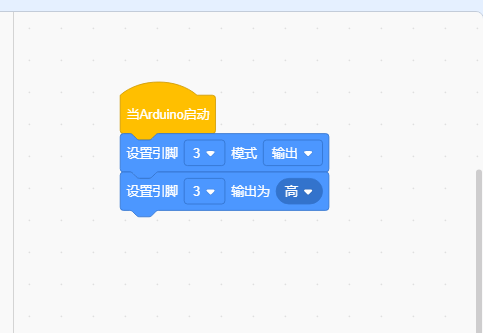

首先“设置引脚 3 模式 输出”，然后“设置引脚 3 输出为 高”。

**2.  主循环**

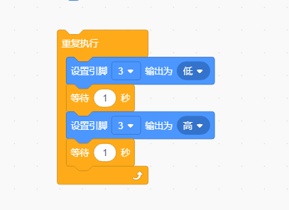

## 实验代码

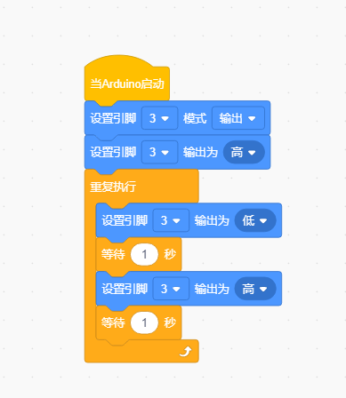

## 实验结果

### 雾化片

**注意：雾化片正面朝上，雾化片轻置于水面之上，正面不要被水覆盖。**

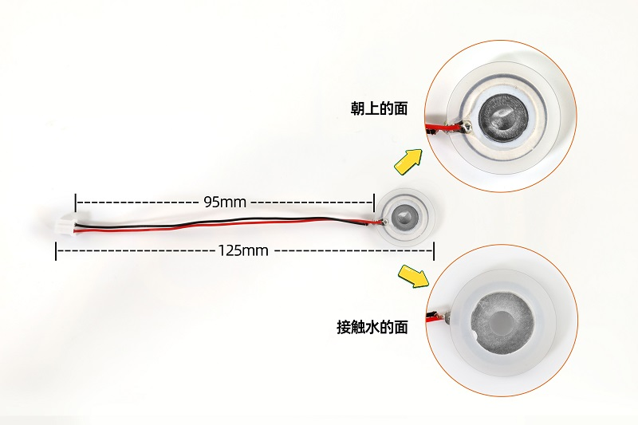

将示例代码上传到主板，上传成功后，按照接线图接好线，把雾化片放水面，雾化片开始工作，按照喷雾1秒，停1秒的规律循环交替。

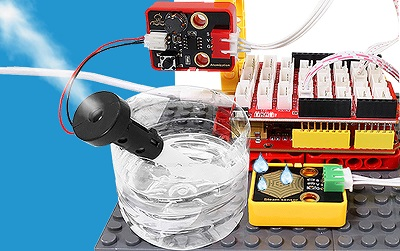

### 加湿棉棒

安装加湿棉棒步骤：

将雾化片安装至塑料支架内部。注意雾化片的方向，雾化片的连接线放置在塑料支架凹槽处。

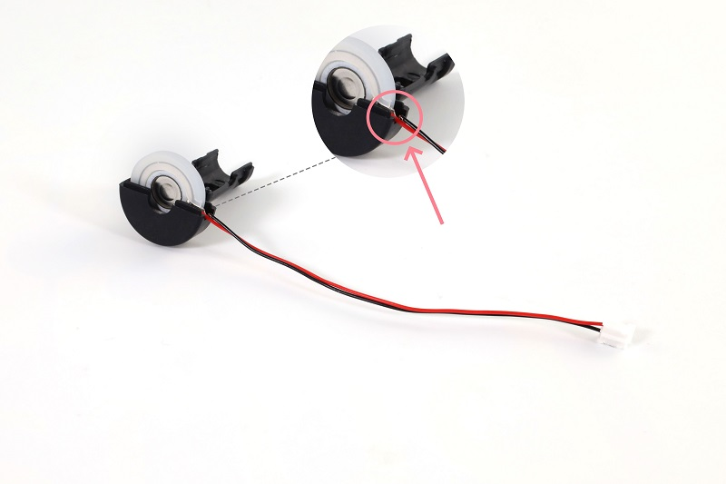

将另一边塑料支架装上。

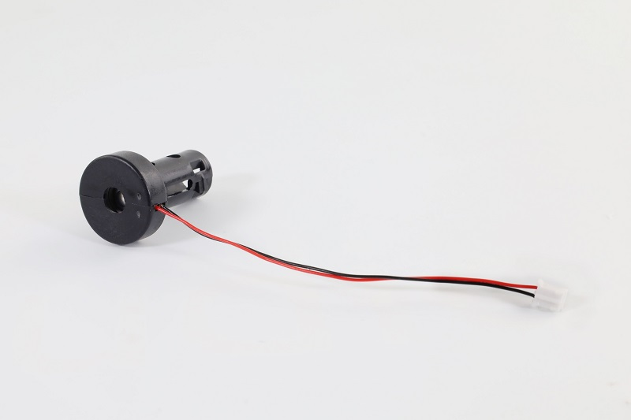

将棉棒插入塑料支架中间。

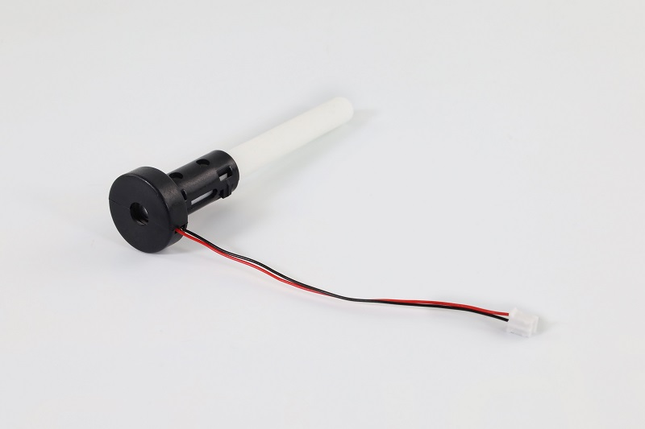

安装完成。

**注意：由于棉棒吸水需要时间，为了避免模块上电后棉棒未吸满水导致雾化片烧坏，请先将棉棒插入水中，待吸满水后再上传代码进行实验。**

按照接线图接好线，把棉棒插入水里，等待2~3分钟棉棒吸满水后，将示例代码上传到主板，上传成功后雾化片开始工作，按照喷雾3秒，停1秒的规律循环交替。

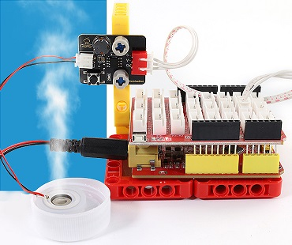

请注意，由于棉棒吸水的速率较慢，长时间工作后可能会导致雾化片每工作一段时间就会停止2~3秒，待棉棒吸水充足后又继续工作。