# Mixly 使用教程

## 资料下载

- 下载代码[atomization_demo(Mixly)](./atomization_demo(Mixly).7z)

## 软件与板卡

打开 Mixly（本教程使用 Mixly 3.0），双击 Mixly.exe 启动，然后用 USB 线把主板连到电脑。

1、在工具栏「板卡」中选择 `Arduino AVR` → `Arduino/Genuino Uno`。

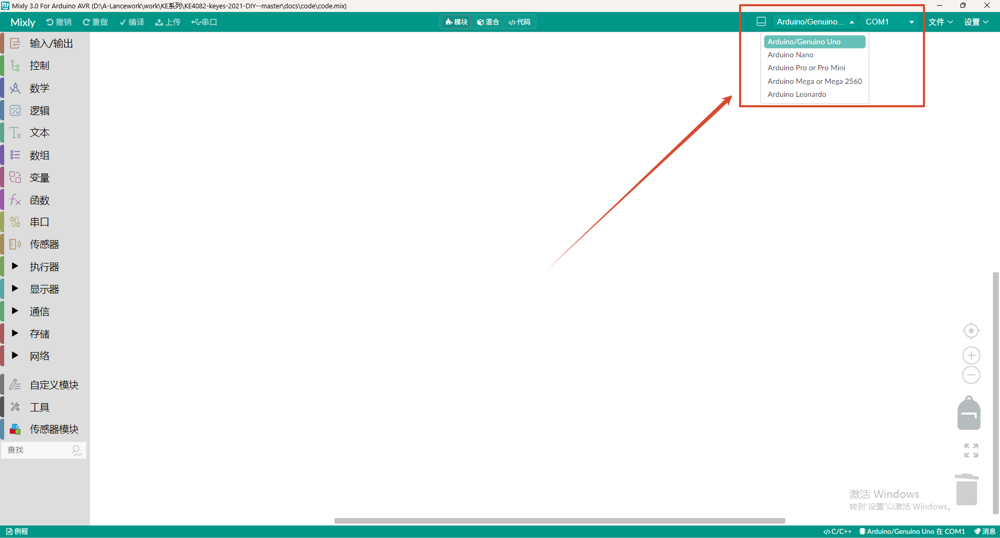

2、在「端口」中选择主板对应的 COM 口，图中为 COM1，实际以你电脑识别到的端口号为准。

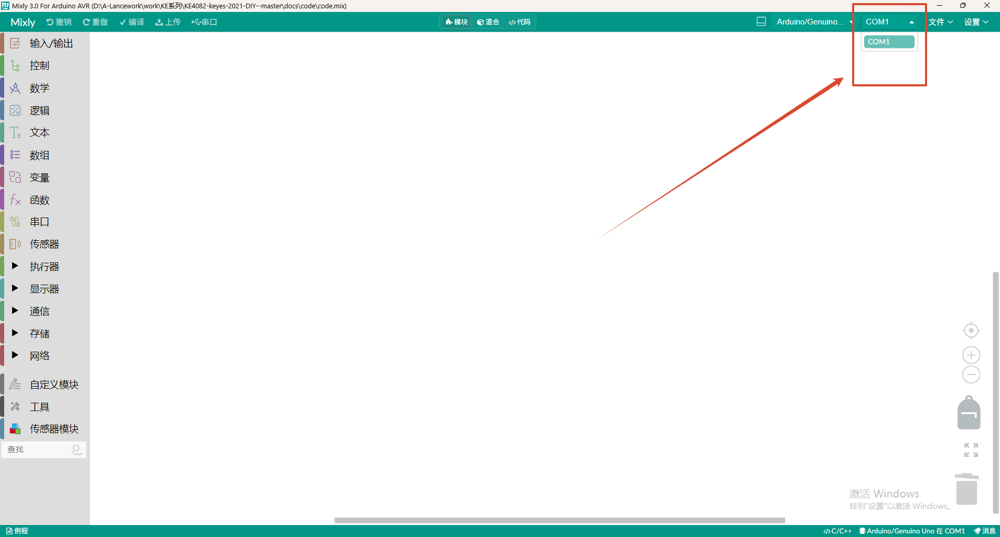

**注意：上传前必须先选对板卡和端口，否则点击「上传」会提示编译或连接错误。**

## 用到的积木

整个程序用到的积木都在左侧积木区里，不需要额外安装扩展库。

| 积木                           | 所在分类  | 作用                                 |
| ------------------------------ | --------- | ------------------------------------ |
| 初始化（绿色帽子块）           | 控制      | 块内的积木只在主板上电后执行一次     |
| 数字输出 管脚 # 3 设为 高 / 低 | 输入/输出 | 设置指定引脚输出高电平或低电平       |
| 延时 毫秒 200                  | 控制      | 将程序的执行暂停一段时间，单位是毫秒 |

三块积木在软件里的位置如下图。红框圈住的是积木本身，左侧红框标出的是它所在的分类。

**初始化**（控制分类）

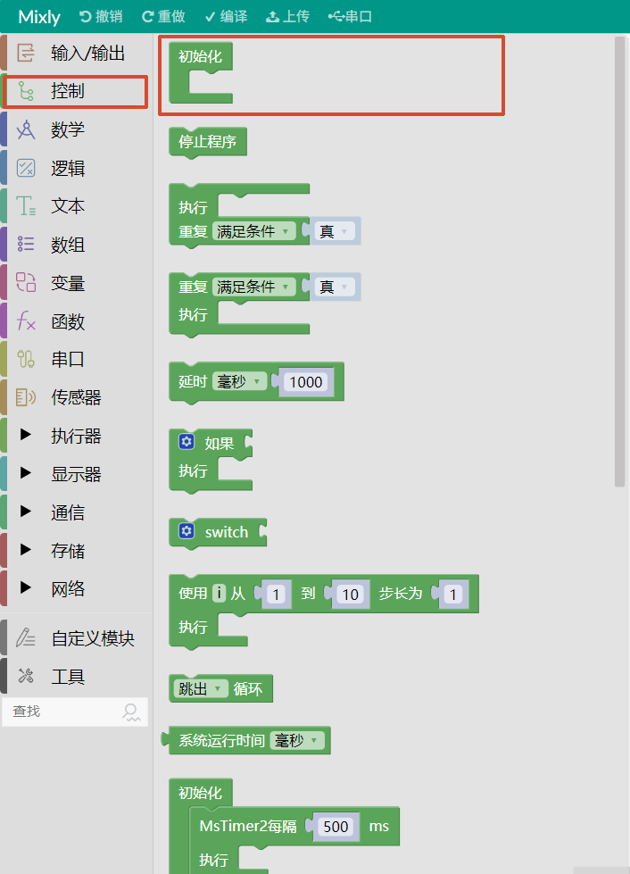

**数字输出**（输入/输出分类）

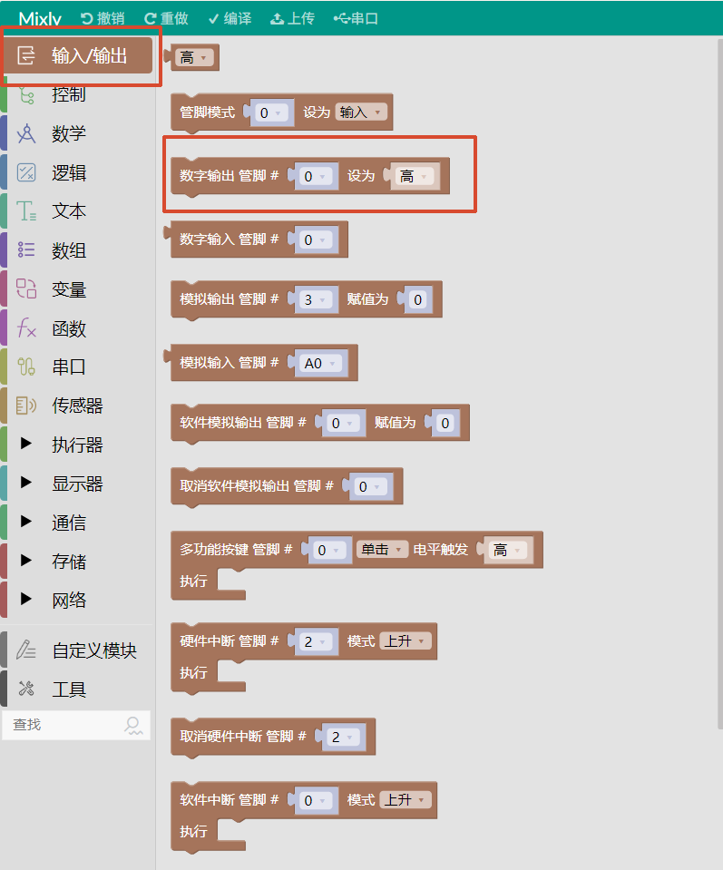

**延时**（控制分类）

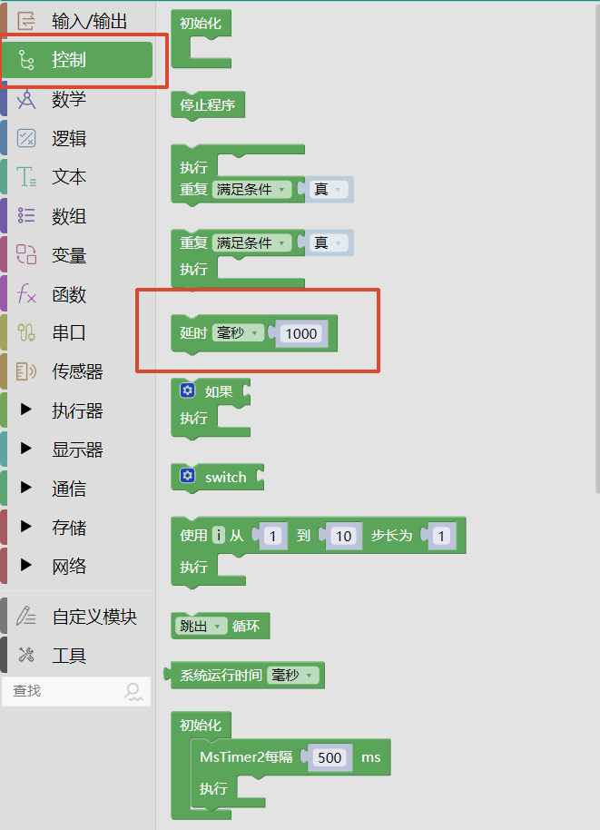

## 积木搭建步骤

1、拖出一块「初始化」积木，它里面的内容只在上电后执行一次。

2、在初始化积木内部放入一块「数字输出 管脚 # `3` 设为 `高`」。

这一步是让模块在上电瞬间保持“松开”状态。如果漏掉这块，引脚上电时默认是低电平，会被当成按下了一次按键，模块一通电就开始喷雾。

3、在初始化积木下方的画布空白处，依次拖出下面 8 块积木。直接放在画布上的积木会自动进入主程序，上电后不断循环执行。

| 顺序 | 积木                          |
| ---- | ----------------------------- |
| 1    | 数字输出 管脚 # `3` 设为 `低` |
| 2    | 延时 `毫秒` `200`             |
| 3    | 数字输出 管脚 # `3` 设为 `高` |
| 4    | 延时 `毫秒` `3000`            |
| 5    | 数字输出 管脚 # `3` 设为 `低` |
| 6    | 延时 `毫秒` `200`             |
| 7    | 数字输出 管脚 # `3` 设为 `高` |
| 8    | 延时 `毫秒` `1000`            |

4、拼好的积木如下图。

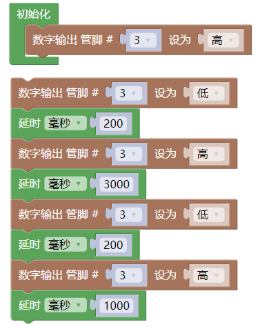

5、点击「上传」，等待提示上传成功。

**注意：积木里的「管脚 #」就是主板的数字引脚号，必须和实际接线一致。S 接在 D3 上，积木里就填 3。**

## 积木与代码对照

| 积木                           | 对应的 Arduino 代码      |
| ------------------------------ | ------------------------ |
| 初始化                         | `void setup() { }`       |
| 画布顶层的积木（初始化以外的） | `void loop() { }`        |
| 数字输出 管脚 # 3 设为 `高`    | `digitalWrite(3, HIGH);` |
| 数字输出 管脚 # 3 设为 `低`    | `digitalWrite(3, LOW);`  |
| 延时 `毫秒` `200`              | `delay(200);`            |
| 无需拖出                       | `pinMode(3, OUTPUT);`    |

## 工作时序

| 顺序 | 积木动作        | 时长      | 模块状态                   |
| ---- | --------------- | --------- | -------------------------- |
| 1    | 数字输出 低电平 | 200 毫秒  | 模拟按键按下，模块开启     |
| 2    | 数字输出 高电平 | 3000 毫秒 | 保持开启，持续喷雾 3 秒    |
| 3    | 数字输出 低电平 | 200 毫秒  | 再次模拟按键按下，模块关闭 |
| 4    | 数字输出 高电平 | 1000 毫秒 | 保持关闭，停止喷雾 1 秒    |

一个完整周期是 200 + 3000 + 200 + 1000 = 4400 毫秒，跑完以后回到第 1 步继续循环。

**注意：第 1 步和第 3 步的 200 毫秒是模拟按键按下的持续时间，不要随意改小。改成几十毫秒模块可能识别不到这次按键，喷雾状态就会停在上一轮。**

## 工程文件

本文档配套的积木工程打包在 `atomization_demo(Mixly).7z` 里，解压后得到 `atomization_demo(Mixly).mix`，用 Mixly 的「打开」直接载入即可，不需要手动拼积木；也可以照着上面的步骤自己拼一遍，两者生成的代码完全一致。

## 实验结果

### 雾化片

**注意：雾化片正面朝上，雾化片轻置于水面之上，正面不要被水覆盖。**

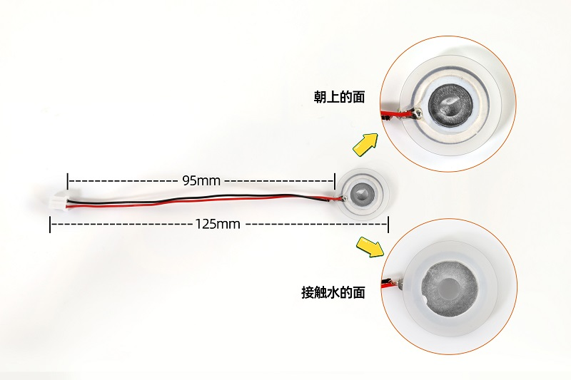

将积木程序上传到主板，上传成功后，按照接线图接好线，把雾化片放水面，雾化片开始工作，按照喷雾3秒，停1秒的规律循环交替。

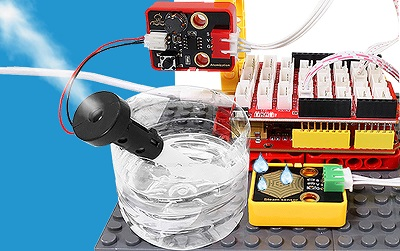

### 加湿棉棒

安装加湿棉棒步骤：

将雾化片安装至塑料支架内部。注意雾化片的方向，雾化片的连接线放置在塑料支架凹槽处。

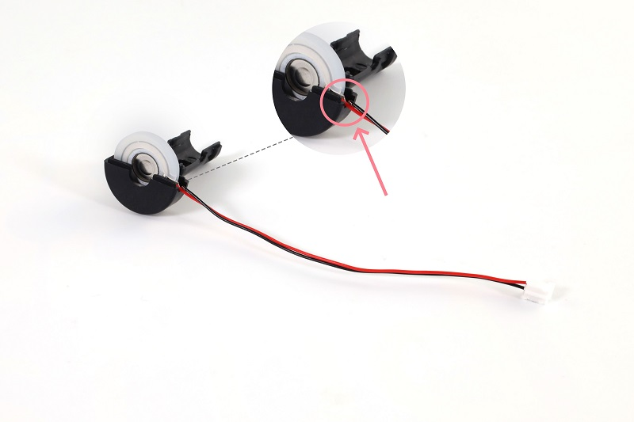

将另一边塑料支架装上。

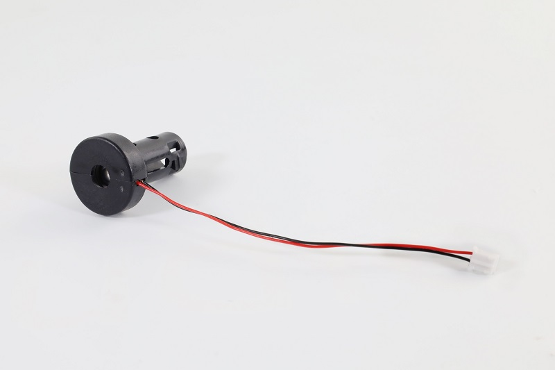

将棉棒插入塑料支架中间。

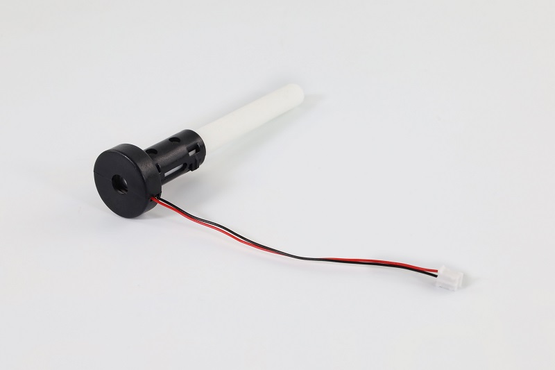

安装完成。

**注意：由于棉棒吸水需要时间，为了避免模块上电后棉棒未吸满水导致雾化片烧坏，请先将棉棒插入水中，待吸满水后再上传程序进行实验。**

按照接线图接好线，把棉棒插入水里，等待2~3分钟棉棒吸满水后，将积木程序上传到主板，上传成功后雾化片开始工作，按照喷雾3秒，停1秒的规律循环交替。

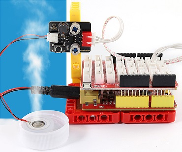

请注意，由于棉棒吸水的速率较慢，长时间工作后可能会导致雾化片每工作一段时间就会停止2~3秒，待棉棒吸水充足后又继续工作。